# baseline vs 2c-6mo-1step-demote

| | A: baseline | B: 2c-6mo-1step-demote |
|---|---|---|
| run | `baseline_allssd_merged_6mo_w25400000_2026-10-23-3` | `demote_tiered_1step_6mo_w25400000_2026-10-26-1` |
| kind | baseline | demotion |
| commit | `57539c60f9` | `005d3099` |
| blocks | 25,400,000 → 25,410,000 | 25,400,000 → 25,409,993 |
| time | 2026-10-23T10:08:48Z → 2026-10-23T10:59:24Z | 2026-10-26T03:57:00Z → 2026-10-26T06:11:30Z |
| report | [baseline_allssd_merged_6mo_w25400000_2026-10-23-3/metrics.md](../baseline_allssd_merged_6mo_w25400000_2026-10-23-3/metrics.md) | [demote_tiered_1step_6mo_w25400000_2026-10-26-1/metrics.md](../demote_tiered_1step_6mo_w25400000_2026-10-26-1/metrics.md) |

Flags baseline:

```
KV_READ_METRICS=true --prune.mode=full --prune.distance.blocks=10000000 --externalcl --no-downloader --maxpeers=0 --exec.state-cache=true --use-offline-bals --offline-bal.dir=/erigon-data/offline-bal-8192-tip --pfb.sync.mode.chaintip --pfb.exec.stop-at-block=25410000 --tiering.lookback-blocks=1296000 --metrics --metrics.addr=127.0.0.1 --metrics.port=6078
```

Flags 2c-6mo-1step-demote:

```
KV_READ_METRICS=true --prune.mode=full --prune.distance.blocks=10000000 --externalcl --no-downloader --maxpeers=0 --exec.state-cache=true --use-offline-bals --offline-bal.dir=/erigon-data/offline-bal-8192-tip --pfb.exec.stop-at-block=25410000 --tiering.commitment-hot-merge-steps=1 --tiering.lookback-blocks=1296000 --tiering.cold-dir=/backup/erigon-hdd/tv2_run_6mo_10k/domain --tiering.demote --metrics --metrics.addr=127.0.0.1 --metrics.port=6080 --pfb.sync.mode.chaintip
```

## Summary

B/A is the ratio of each value, in the same order as the values.

| Metric | A: baseline | B: 2c-6mo-1step-demote | B/A |
|---|---|---|---|
| blocks executed | 10,000 | 9,993 | 1.00× |
| wall time | 0.84 h | 2.24 h | 2.66× |
| blocks per second (mean) | 3.29 | 1.24 | 0.38× |
| Mgas/s per block mean / p50 / p5 | 277.00 / 272.02 / 128.63 | 69.28 / 67.19 / 17.97 | 0.25× / 0.25× / 0.14× |
| Mgas/s wall clock (all-in) | 100.11 | 37.60 | 0.38× |
| exec time per block (exec + commitment) p50 / p90 / p95 / p99 | 99.0 ms / 198.8 ms / 258.4 ms / 391.0 ms | 400.4 ms / 1.35 s / 2.13 s / 4.40 s | 4.04× / 6.79× / 8.24× / 11.26× |
| exec time per block (exec + commitment) worst | 1.26 s | 10.81 s | 8.59× |
| exec time per block (exec + commitment) mean ± 95% CI (30 s windows) | 123.1 ms ± 8.6 ms (n=100) | 718.5 ms ± 43.0 ms (n=266) | 5.84× / 5.03× |
| commitment time per block p50 / p90 / p95 / p99 | 22.4 ms / 49.9 ms / 73.4 ms / 135.6 ms | 154.2 ms / 987.0 ms / 1.73 s / 3.71 s | 6.89× / 19.78× / 23.63× / 27.34× |
| commitment time per block worst | 392.6 ms | 10.55 s | 26.86× |
| commitment time per block mean ± 95% CI (30 s windows) | 31.2 ms ± 3.2 ms (n=100) | 456.5 ms ± 41.7 ms (n=266) | 14.64× / 13.22× |
| ssd probes per block mean / p50 / p90 / p95 / p99 | 3,934 / 5,547 / 9,688 / 15,958 / 27,934 | 162,371 / 98,783 / 455,509 / 757,022 / 998,232 | 41.27× / 17.81× / 47.02× / 47.44× / 35.74× |
| hdd probes per block mean / p50 / p90 / p95 / p99 | 0 / 0 / 0 / 0 / 0 | 267.39 / 470.56 / 923.19 / 979.77 / 7,198 | — / — / — / — / — |
| hdd slow probes per block mean / p50 / p90 / p95 / p99 | 0 / 0 / 0 / 0 / 0 | 43.64 / 53.73 / 119.18 / 560.92 / 914.31 | — / — / — / — / — |
| share of probes on HDD | 0.00% | 0.16% | — |
| share of lookups that reached HDD | 0.00% | 6.85% | — |
| HDD probe latency p50 / p90 / p95 / p99 | — / — / — / — | 2.2 µs / 7.7 ms / 14.4 ms / 24.4 ms | — / — / — / — |
| SSD probe latency p50 / p90 / p95 / p99 (sampled) | 1.9 µs / 126.7 µs / 210.7 µs / 434.9 µs | 2.0 µs / 7.5 µs / 35.8 µs / 1.6 ms | 1.04× / 0.06× / 0.17× / 3.64× |
| HDD probes per lookup that reached HDD: mean / share > 1 / share > 4 | — / — / — | 3.70 / 99.65% / 17.95% | — / — / — |
| existence-filter false positives (HDD / SSD) | 0 / 0 | 0 / 0 | — / — |
| commitment data size on HDD (end) | 0 B | 189.28 GB | — |
| commitment data size on SSD (end) | 311.67 GB | 729.37 GB | 2.34× |
| commitment index size on SSD (end) | 6.73 GB | 12.93 GB | 1.92× |
| commitment data + index size, SSD + HDD (end) | 318.40 GB | 931.58 GB | 2.93× |
| SSD space saved (commitment data on HDD) (end) | 0 B | 189.28 GB | — |
| duplicate bytes (max) | 0 B | 1.14 GB | — |
| movement lag, straddling_file (blocks: max / end) | 22,135 / 22,135 | 1,941 / 342 | 0.09× / 0.02× |
| movement lag, copy_pending (blocks: max / end) | 24,091,854 / 24,091,854 | 1,952 / 0 | 0.00× / 0.00× |
| HDD end block / SSD start block (end) | 0 / 0 | 24,113,651 / 24,113,651 | — / — |
| cold merges: count / total seconds / paused seconds | 0 / 0.0 µs / 0.0 µs | 3.00 / 122.74 s / 26.09 s | — / — / — |
| cold merges: bytes read / written | 0 B / 0 B | 13.08 GB / 9.86 GB | — / — |
| major page faults per block | 930.03 | 1,659 | 1.78× |
| hdd reads per block / read bytes per block | 0 / 0 B | 50.64 / 705.93 KB | — / — |
| hdd r_await (mean) / utilization (mean) | — / 0.00% | 10.4 ms / 35.10% | — / — |
| ssd reads per block / read bytes per block | 940.78 / 4.72 MB | 1,630 / 8.47 MB | 1.73× / 1.79× |
| ssd r_await (mean) / utilization (mean) | 146.2 µs / 36.60% | 158.7 µs / 24.84% | 1.09× / 0.68× |

## Graphs

Solid/dashed styles are series; color is the run (blue = baseline, orange = 2c-6mo-1step-demote).

### Execution block

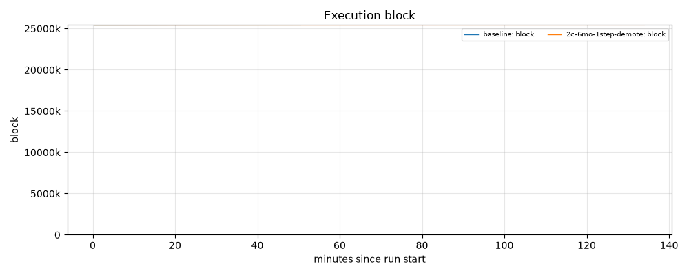

### Blocks per second

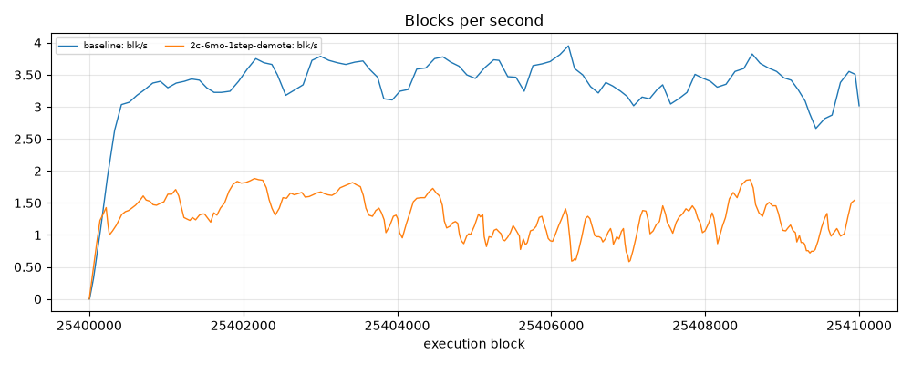

### Mgas/s per block

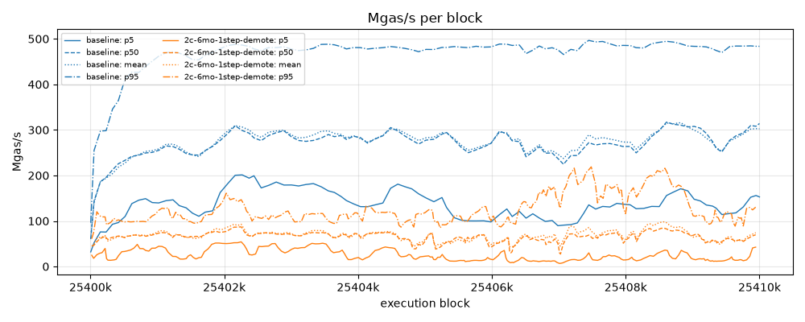

### Exec time per block (exec + commitment)

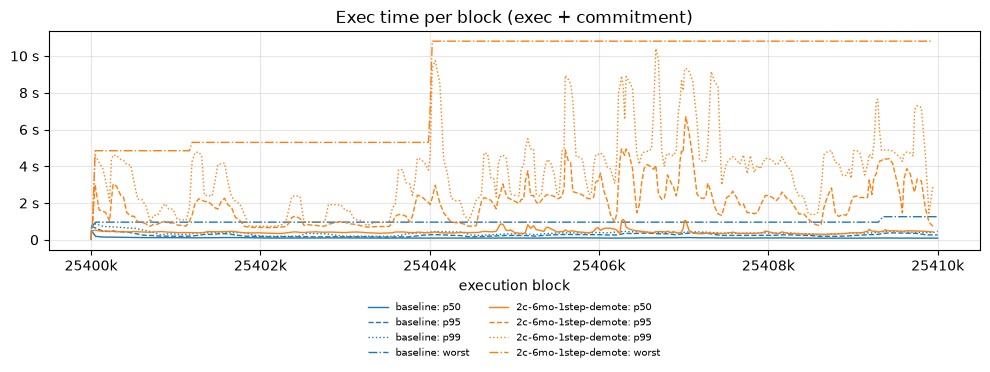

### Commitment time per block

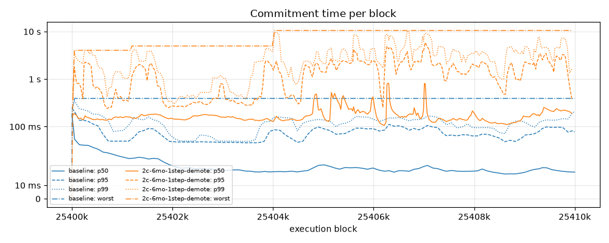

### Commitment file probes per block

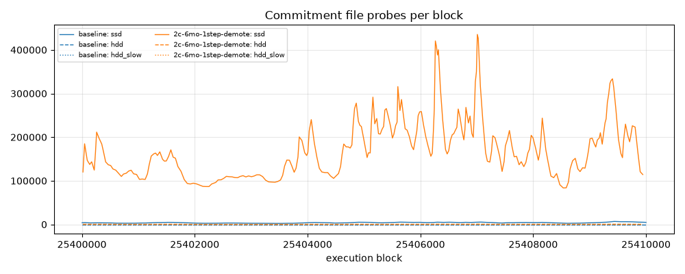

### Share of probes and lookups on HDD

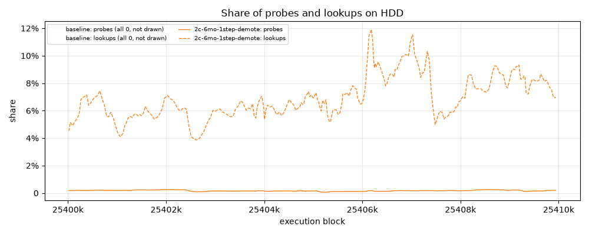

### Slow probes (> 1 ms) per second

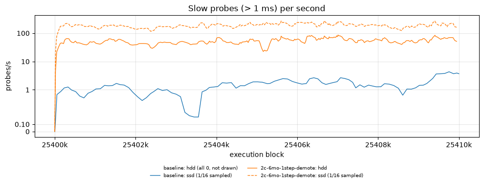

### Commitment data size per tier

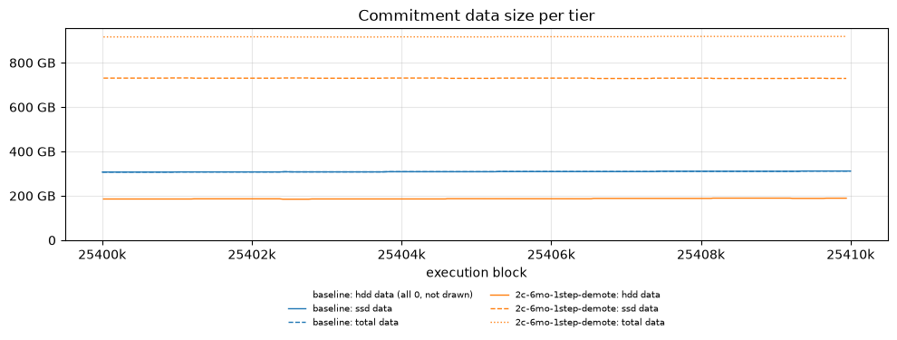

### Commitment index size per tier

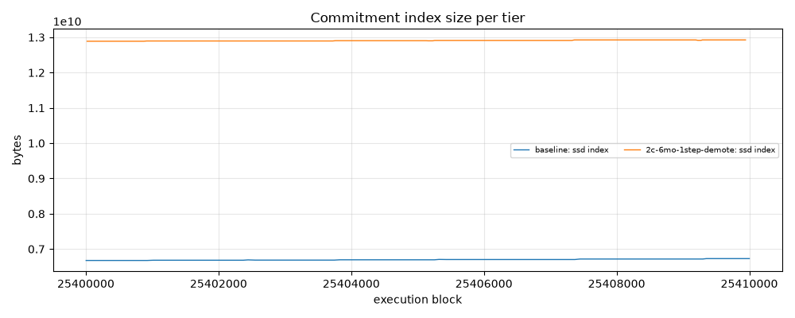

### SSD space saved and duplicate size

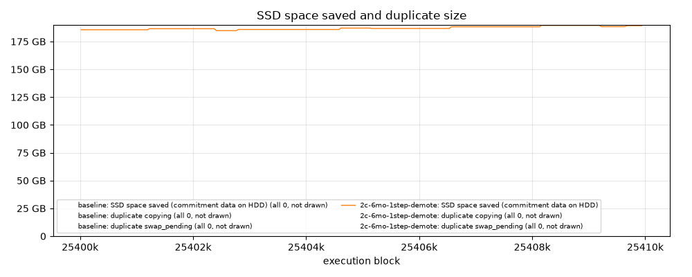

### Cold data still on SSD (commitment)

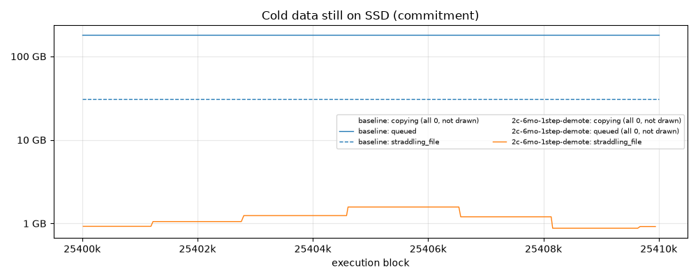

### Movement lag behind the cold boundary (commitment)

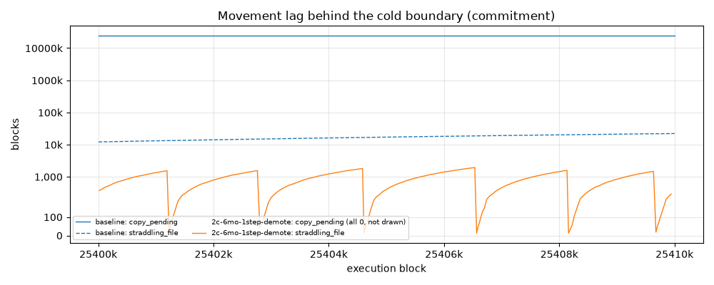

### Tier edges (blocks)

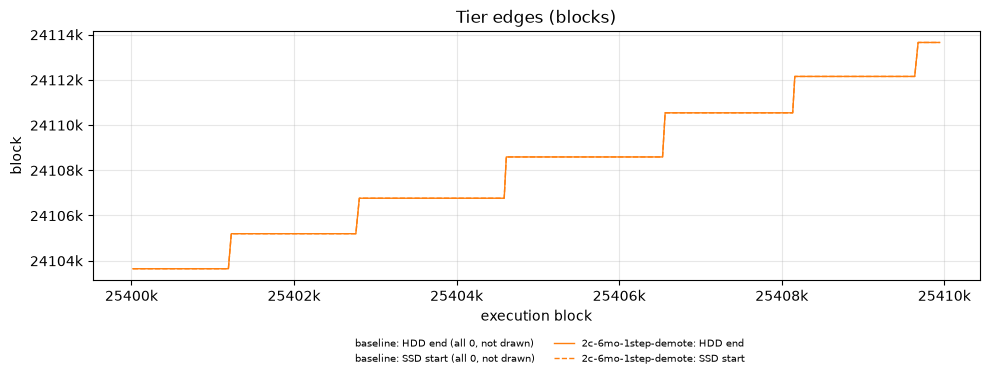

### Demotions (commitment)

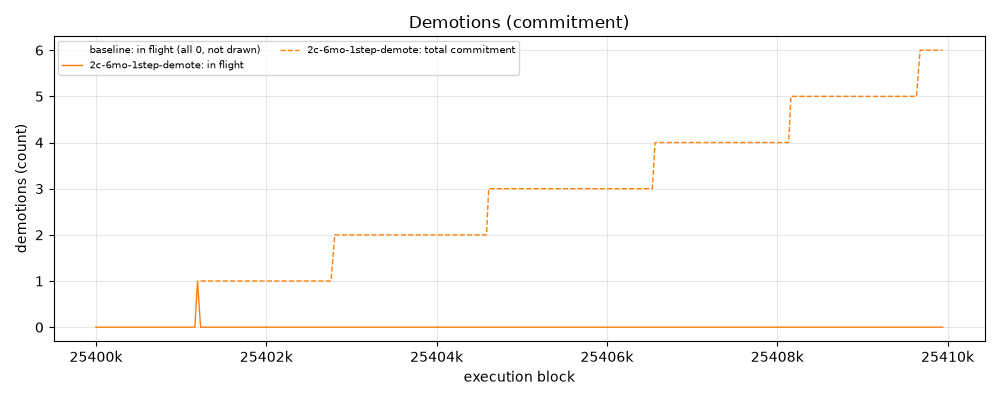

### Demoted bytes and copy rate

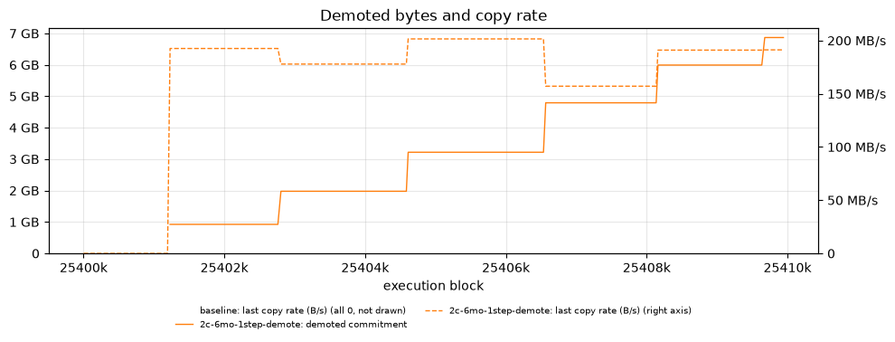

### Demotion time and pauses

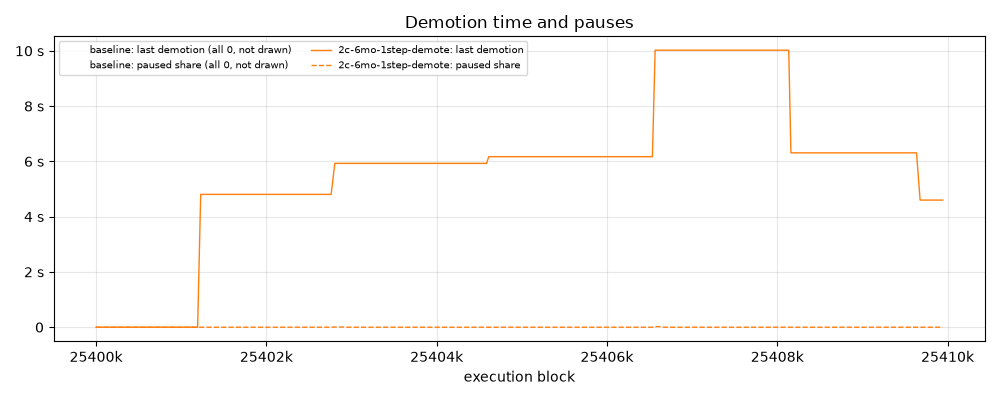

### Cold merges (commitment, HDD)

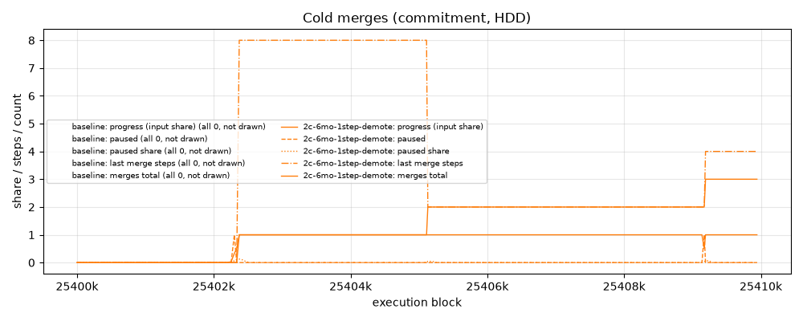

### Cold merge bytes

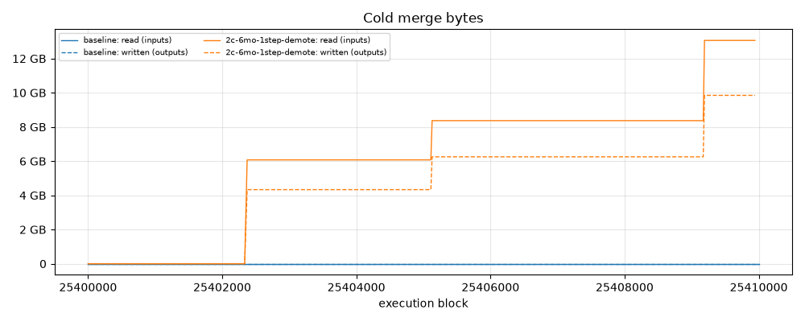

### Major page faults per second

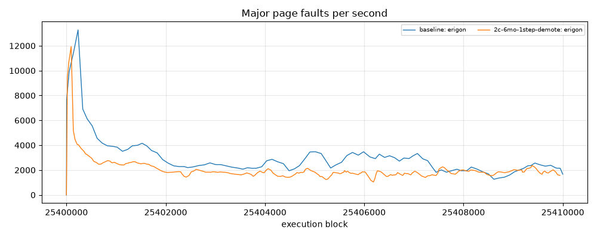

### Disk reads per second

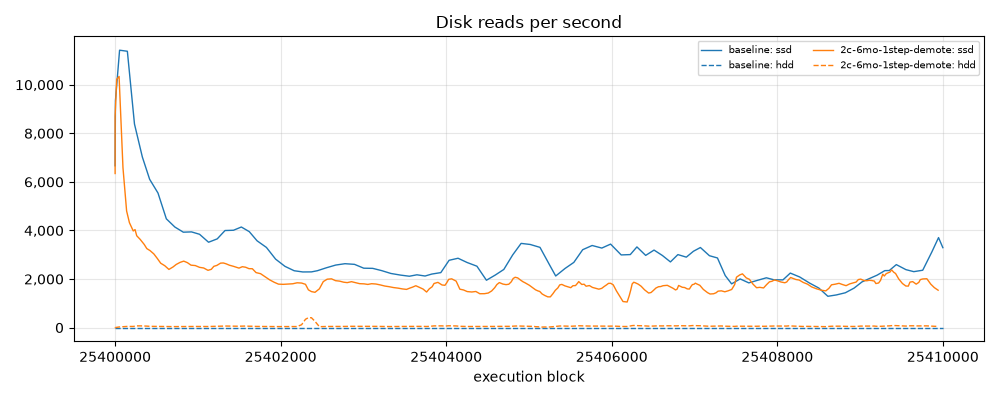

### Disk read bytes per second

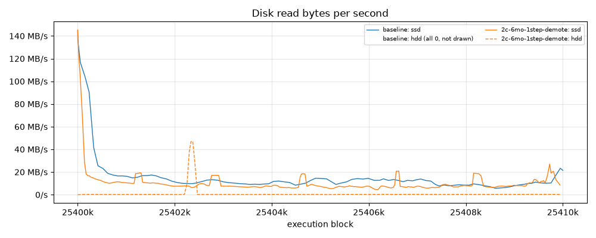

### SSD read latency (r_await)

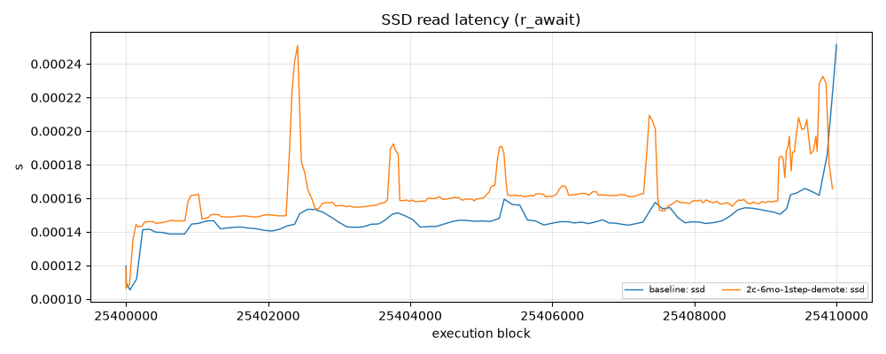

### HDD read latency (r_await)

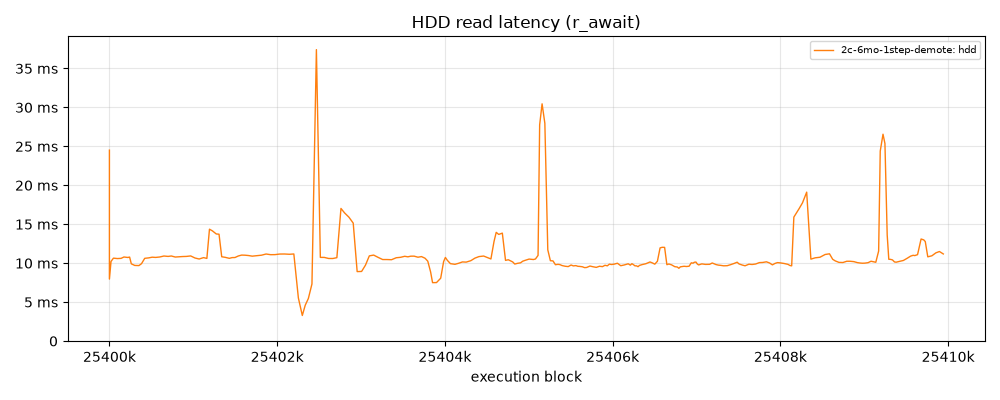

### Disk utilization

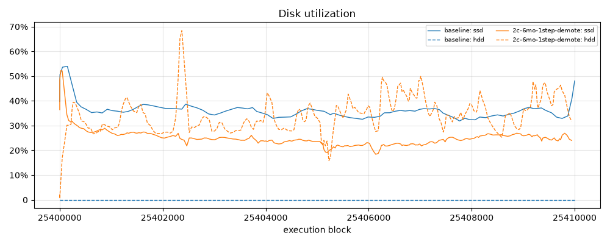

Not drawn (heatmaps or no data in both runs): HDD probe latency, SSD probe latency (sampled), HDD probes per lookup (lookups that reached HDD).
