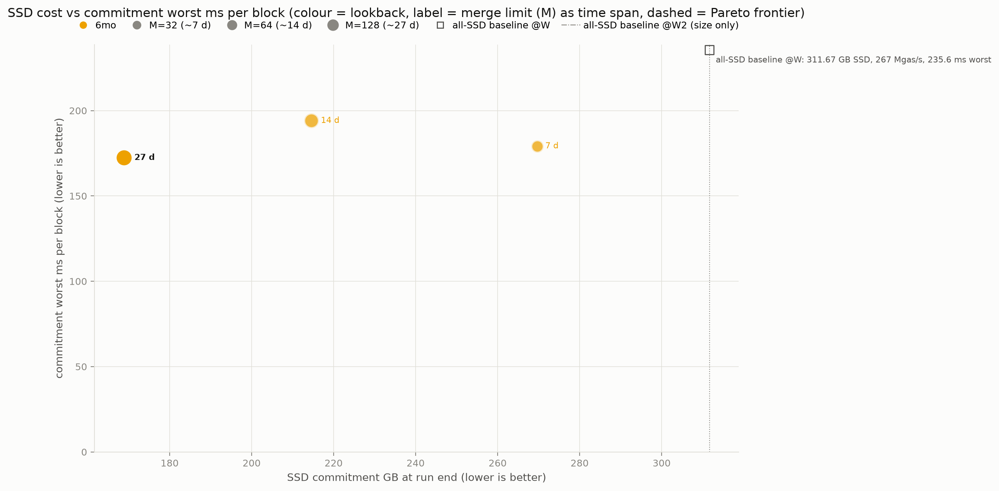
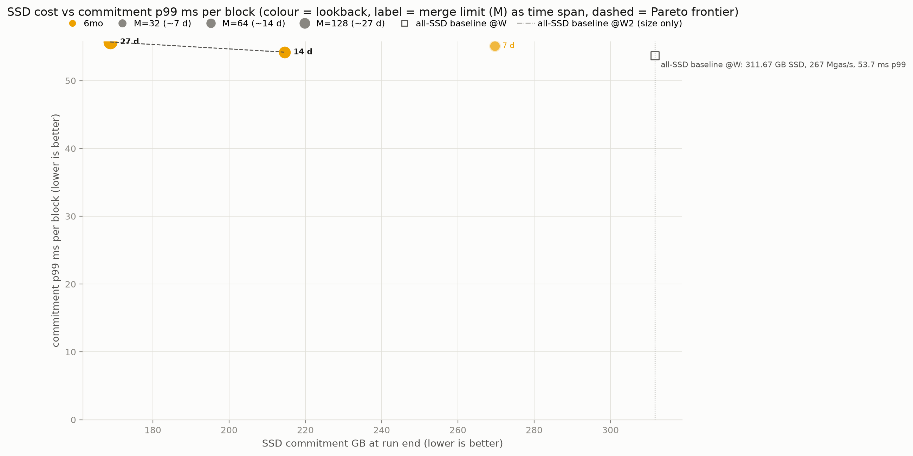
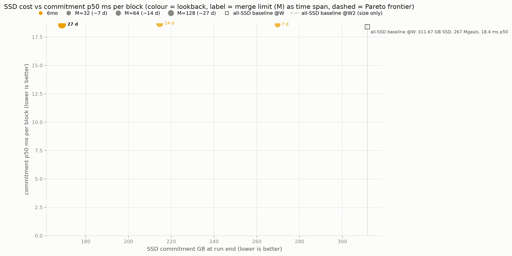
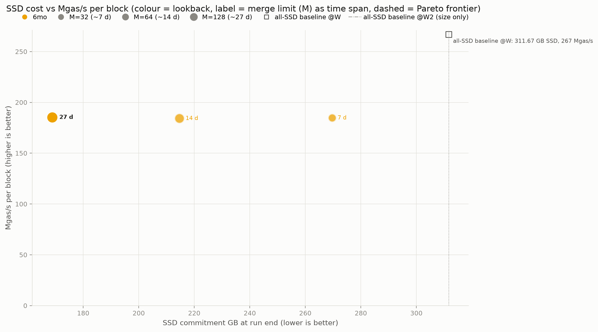

# Main merge check: latest tiering head, 10,000 blocks (stage 17.1)

All runs: 10,000 chaintip blocks 25,400,001..25,410,000 from W = 25,400,000, offline BALs, state cache on, erigon f32236ec74
(PR #26728 head 78ae5e039a + local switches that are off by default), 64 GiB memory scope (page cache included), page caches dropped before the start,
env `KV_READ_METRICS=false BAL_BATCH_PREFETCH=false` (io_uring BAL batch prefetch off).
- `allssd`: all-SSD baseline (fresh mirror of `tv2_bl_base`, 256-step merged commitment).
- `long_m32`, `long_m64`, `long_m128`: tiered 6mo, M = 32 / 64 / 128 (`--tiering.commitment-hot-merge-steps`), cold files on `/sbackup`,
  demotion on, `--tiering.cold-io-max-mbps=50`.

| metric | allssd | long_m32 | long_m64 | long_m128 |
|---|---|---|---|---|
| Mgas/s per block mean / p50 / p5 / p1 | 266.68 / 259.08 / 122.13 / 82.45 | 184.67 / 177.36 / 60.14 / 36.23 | 184.16 / 176.93 / 58.85 / 36.35 | 185.20 / 177.49 / 59.47 / 37.03 |
| exec time per block (exec + commitment) p50 / p90 / p95 / p99 | 109.6 ms / 213.0 ms / 265.0 ms / 388.7 ms | 152.1 ms / 392.7 ms / 608.8 ms / 1.01 s | 152.3 ms / 391.7 ms / 608.1 ms / 1.01 s | 152.3 ms / 392.1 ms / 607.4 ms / 1.04 s |
| commitment time per block p50 / p90 / p95 / p99 | 18.4 ms / 36.1 ms / 43.9 ms / 53.7 ms | 18.6 ms / 36.6 ms / 44.2 ms / 55.1 ms | 18.7 ms / 36.9 ms / 44.3 ms / 54.2 ms | 18.6 ms / 36.7 ms / 44.3 ms / 55.7 ms |
| commitment time per block worst | 235.6 ms | 179.2 ms | 194.1 ms | 172.4 ms |
| exec time per block (exec + commitment) worst | 777.4 ms | 3.11 s | 3.11 s | 3.07 s |
| hdd probes per block mean / p50 / p90 / p95 / p99 | 0 / 0 / 0 / 0 / 0 | 311.51 / 478.99 / 950.62 / 2,258 / 8,452 | 311.24 / 479.59 / 950.55 / 2,241 / 8,448 | 311.83 / 479.77 / 951.29 / 2,331 / 8,466 |
| HDD probe latency p50 / p90 / p95 / p99 | — / — / — / — | 0.7 µs / 17.5 ms / 38.9 ms / 94.2 ms | 0.7 µs / 17.5 ms / 38.9 ms / 94.3 ms | 0.7 µs / 17.5 ms / 39.0 ms / 94.5 ms |
| major page faults per block | 1,088 | 1,152 | 1,114 | 1,093 |
| hdd reads per block / read bytes per block | 0 / 0 B | 48.50 / 198.70 KB | 48.42 / 198.38 KB | 48.38 / 198.23 KB |
| hdd r_await (mean) / utilization (mean) | — / 0.32% | 30.3 ms / 35.38% | 30.3 ms / 35.49% | 30.5 ms / 35.71% |
| ssd reads per block / read bytes per block | 1,110 / 5.57 MB | 1,155 / 6.20 MB | 1,117 / 6.10 MB | 1,095 / 5.97 MB |
| blocks executed | 10,000 | 9,979 | 9,983 | 9,987 |
| run checks | done rc=0 root_errors=0 | rc=0 root_errors=0 oom_kill=0 memmax64g=1 precheck_after=FAIL io_uring_disabled_lines=0 stats_lines=10000 files_changed=0 files_removed=44 | rc=0 root_errors=0 oom_kill=0 memmax64g=1 precheck_after=FAIL io_uring_disabled_lines=0 stats_lines=10000 files_changed=0 files_removed=44 | rc=0 root_errors=0 oom_kill=0 memmax64g=1 precheck_after=FAIL io_uring_disabled_lines=0 stats_lines=10000 files_changed=0 files_removed=44 |
