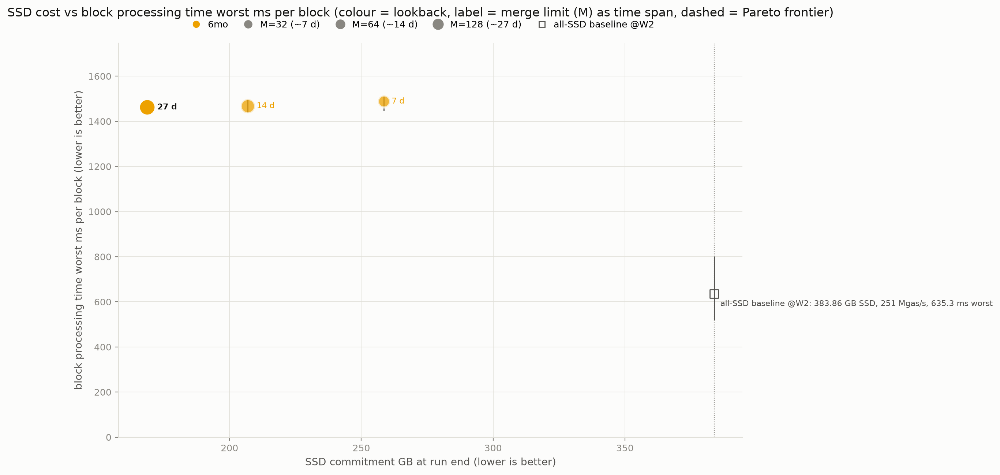
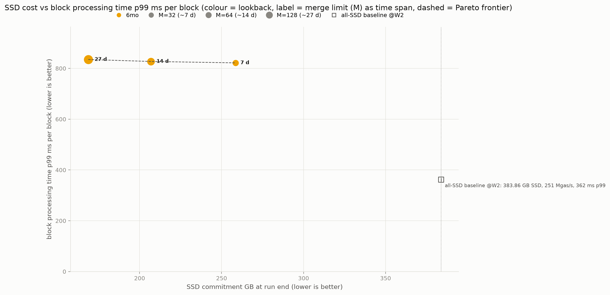
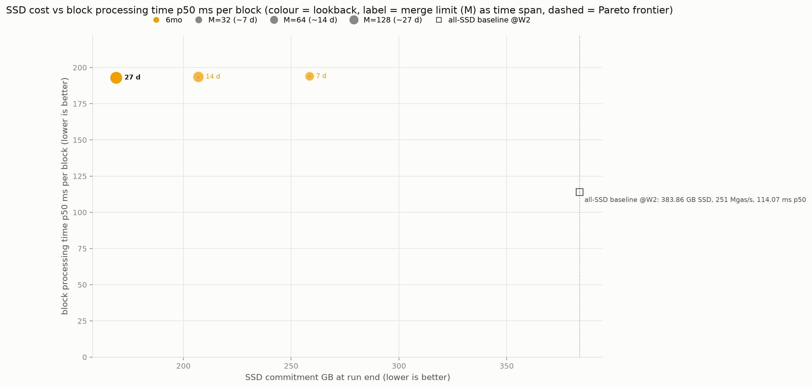
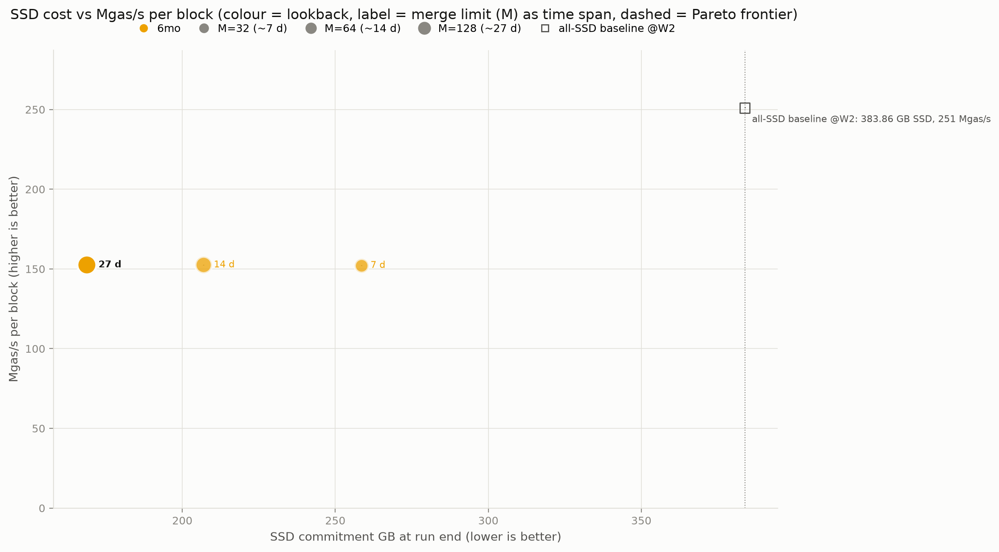

# Main merge check at W2: latest tiering head, 10,000 blocks, 3 repeats (stage 17.1)

All runs: 10,000 chaintip blocks 26,130,001..26,140,000 from W2 = 26,130,000, offline BALs, state cache on, erigon f32236ec74
(PR #26728 head 78ae5e039a + local switches that are off by default), 64 GiB memory scope (page cache included), page caches dropped before the start,
env `KV_READ_METRICS=false BAL_BATCH_PREFETCH=false` (io_uring BAL batch prefetch off). Each setting ran 3 times (`_r1`..`_r3`).
- `w2_allssd_rN`: all-SSD baseline (mirror of `tv2_1s_base_w2` + default `seg retire`).
- `w2_m32_rN`, `w2_m64_rN`, `w2_m128_rN`: tiered 6mo, M = 32 / 64 / 128 (`--tiering.commitment-hot-merge-steps`), cold files on `/sbackup`,
  demotion on, `--tiering.cold-io-max-mbps=50`.

Charts: mean of the 3 repeats; the vertical bar is the min..max over the repeats (data: `frontier/frontier.json`).

Block processing time per block = the `parallel done in=` span of each one-block `ExecV3` cycle, read from the run log for all 10,000 blocks
(same span as `exec_block_seconds`, without histogram buckets; `<run>/block_processing.json`). It covers the BAL warmup, execution, commitment fold and root.
It excludes the MDBX flush/commit, the other stages and pruning, which run synchronously between blocks. It is not the time of an engine API newPayload call:
senders come from the read-ahead cache, the engine API work is not timed, the read-ahead touches block N+500, and background
build / merge / demotion runs about 36 times more often per block than at the tip (blocks back to back, not 12 s slots).
The commitment time rows below count only the fold, not the warmup: do not use them alone.

## Block processing time: worst case

## Block processing time: p99

## Block processing time: p50

## Throughput: Mgas/s

## All metrics

| metric | w2_allssd_r1 | w2_allssd_r2 | w2_allssd_r3 | w2_m32_r1 | w2_m32_r2 | w2_m32_r3 | w2_m64_r1 | w2_m64_r2 | w2_m64_r3 | w2_m128_r1 | w2_m128_r2 | w2_m128_r3 |
|---|---|---|---|---|---|---|---|---|---|---|---|---|
| block processing time per block (log) mean / p50 / p99 / worst | 129.4 / 114.2 / 367.7 / 801.2 ms (blk 26130724) | 129.3 / 114.3 / 354.5 / 519.6 ms (blk 26136518) | 129.5 / 113.7 / 363.8 / 585.1 ms (blk 26135166) | 224.9 / 194.5 / 825.9 / 1510.3 ms (blk 26137517) | 223.9 / 193.7 / 823.4 / 1446.5 ms (blk 26138556) | 224.0 / 193.7 / 815.8 / 1507.9 ms (blk 26138556) | 224.1 / 193.8 / 829.1 / 1467.0 ms (blk 26137517) | 223.8 / 192.9 / 823.5 / 1499.3 ms (blk 26137517) | 224.0 / 193.9 / 829.0 / 1437.3 ms (blk 26138556) | 224.0 / 192.7 / 836.6 / 1443.8 ms (blk 26138556) | 224.1 / 192.5 / 832.8 / 1456.6 ms (blk 26138556) | 224.1 / 193.7 / 835.4 / 1486.1 ms (blk 26137517) |
| Mgas/s per block mean / p50 / p5 / p1 | 251.56 / 248.59 / 125.56 / 88 | 250.94 / 247.89 / 126.07 / 88.56 | 251.03 / 248.10 / 127.04 / 88.46 | 151.97 / 146.82 / 61.92 / 42.01 | 152.44 / 147.81 / 62.54 / 42.50 | 152.21 / 147.34 / 62.68 / 42.08 | 152.43 / 147.30 / 62.78 / 41.95 | 152.65 / 147.72 / 62.36 / 41.74 | 152.53 / 147.15 / 62.74 / 42.06 | 152.57 / 147.87 / 62.48 / 42.02 | 152.57 / 147.76 / 62.23 / 42.26 | 152.53 / 147.13 / 62.60 / 41.39 |
| exec time per block (exec + commitment) p50 / p90 / p95 / p99 | 119.1 ms / 219.7 ms / 262.0 ms / 384.2 ms | 119.7 ms / 220.7 ms / 258.6 ms / 372.9 ms | 119.2 ms / 221.8 ms / 264.3 ms / 376.3 ms | 195.3 ms / 376.0 ms / 482.7 ms / 853.0 ms | 194.3 ms / 373.2 ms / 482.8 ms / 831.9 ms | 194.4 ms / 373.7 ms / 481.0 ms / 837.1 ms | 194.3 ms / 373.7 ms / 478.3 ms / 837.1 ms | 193.4 ms / 373.6 ms / 480.6 ms / 846.4 ms | 194.6 ms / 374.3 ms / 479.8 ms / 839.2 ms | 193.8 ms / 374.0 ms / 479.1 ms / 845.6 ms | 193.9 ms / 375.1 ms / 479.7 ms / 832.8 ms | 194.0 ms / 374.6 ms / 478.6 ms / 837.8 ms |
| commitment time per block p50 / p90 / p95 / p99 | 18.2 ms / 33.5 ms / 42.2 ms / 49.1 ms | 18.3 ms / 34.2 ms / 42.5 ms / 49.1 ms | 18.3 ms / 33.8 ms / 42.3 ms / 49.1 ms | 18.3 ms / 32.9 ms / 41.9 ms / 49.2 ms | 18.3 ms / 33.3 ms / 42.0 ms / 48.9 ms | 18.4 ms / 33.7 ms / 42.3 ms / 49.2 ms | 18.3 ms / 32.9 ms / 41.9 ms / 49.1 ms | 18.3 ms / 33.1 ms / 41.8 ms / 48.8 ms | 18.3 ms / 32.9 ms / 41.8 ms / 49.0 ms | 18.3 ms / 32.7 ms / 41.7 ms / 49.0 ms | 18.4 ms / 33.4 ms / 42.1 ms / 49.0 ms | 18.3 ms / 32.6 ms / 41.6 ms / 48.8 ms |
| commitment time per block worst | 156.8 ms | 200.7 ms | 233.4 ms | 157.2 ms | 142.4 ms | 209.7 ms | 159.9 ms | 145.1 ms | 332.5 ms | 122.4 ms | 151.1 ms | 170.0 ms |
| exec time per block (exec + commitment) worst | 801.4 ms | 519.8 ms | 585.3 ms | 1.51 s | 1.45 s | 1.51 s | 1.47 s | 1.50 s | 1.44 s | 1.44 s | 1.46 s | 1.49 s |
| hdd probes per block mean / p50 / p90 / p95 / p99 | 0 / 0 / 0 / 0 / 0 | 0 / 0 / 0 / 0 / 0 | 0 / 0 / 0 / 0 / 0 | 423.85 / 555.50 / 950.55 / 999.94 / 8,198 | 423.58 / 555.03 / 949.77 / 999.11 / 8,167 | 423.26 / 555.63 / 950.80 / 1,036 / 8,207 | 423.68 / 555.29 / 950.95 / 1,073 / 8,215 | 423.76 / 555.45 / 950.86 / 1,052 / 8,210 | 423.15 / 555.28 / 950.07 / 999.42 / 8,179 | 423.57 / 555.39 / 950.56 / 999.96 / 8,198 | 423.46 / 555.59 / 951.10 / 1,097 / 8,219 | 423.52 / 555.39 / 950.81 / 1,042 / 8,208 |
| HDD probe latency p50 / p90 / p95 / p99 | — / — / — / — | — / — / — / — | — / — / — / — | 0.7 µs / 7.9 ms / 33.4 ms / 96.3 ms | 0.7 µs / 7.9 ms / 33.1 ms / 95.9 ms | 0.7 µs / 7.9 ms / 33.1 ms / 96.0 ms | 0.7 µs / 7.9 ms / 33.4 ms / 96.2 ms | 0.7 µs / 7.9 ms / 33.2 ms / 96.1 ms | 0.7 µs / 7.9 ms / 33.2 ms / 96.2 ms | 0.7 µs / 7.9 ms / 33.3 ms / 96.2 ms | 0.7 µs / 7.9 ms / 33.5 ms / 96.2 ms | 0.7 µs / 7.9 ms / 33.4 ms / 96.4 ms |
| major page faults per block | 857.70 | 860.44 | 856.01 | 875.56 | 875.47 | 875.98 | 848.91 | 849.90 | 851.09 | 839.15 | 837.20 | 835.71 |
| hdd reads per block / read bytes per block | 0 / 0 B | 0 / 0 B | 0 / 0 B | 44.20 / 181.20 KB | 44.03 / 180.52 KB | 43.98 / 180.35 KB | 43.94 / 180.19 KB | 44.04 / 180.63 KB | 44.05 / 180.61 KB | 44.03 / 180.53 KB | 44.08 / 180.71 KB | 43.97 / 180.33 KB |
| hdd r_await (mean) / utilization (mean) | — / 0.33% | — / 0.33% | — / 0.32% | 37.8 ms / 40.23% | 37.5 ms / 39.90% | 37.5 ms / 39.73% | 37.7 ms / 40.06% | 37.6 ms / 40.13% | 37.6 ms / 40.12% | 37.8 ms / 40.21% | 37.8 ms / 40.29% | 37.8 ms / 40.22% |
| ssd reads per block / read bytes per block | 872.29 / 4.66 MB | 863.25 / 4.37 MB | 871.41 / 4.70 MB | 866.65 / 4.44 MB | 869.24 / 4.43 MB | 880.46 / 4.73 MB | 851.46 / 4.61 MB | 854.71 / 4.65 MB | 837.74 / 4.30 MB | 840.27 / 4.42 MB | 821.68 / 4.21 MB | 839.89 / 4.55 MB |
| blocks executed | 10,000 | 9,995 | 10,000 | 9,973 | 10,000 | 10,000 | 9,998 | 9,982 | 9,997 | 9,989 | 9,991 | 9,993 |
| run checks | done rc=0 root_errors=0 blocks=blk=26140000 | done rc=0 root_errors=0 blocks=blk=26140000 | done rc=0 root_errors=0 blocks=blk=26140000 | rc=0 root_errors=0 oom_kill=0 memmax64g=1 precheck_after=OK io_uring_disabled_lines=0 stats_lines=10000 files_changed=0 files_removed=0 | rc=0 root_errors=0 oom_kill=0 memmax64g=1 precheck_after=OK io_uring_disabled_lines=0 stats_lines=10000 files_changed=0 files_removed=0 | rc=0 root_errors=0 oom_kill=0 memmax64g=1 precheck_after=OK io_uring_disabled_lines=0 stats_lines=10000 files_changed=0 files_removed=0 | rc=0 root_errors=0 oom_kill=0 memmax64g=1 precheck_after=OK io_uring_disabled_lines=0 stats_lines=10000 files_changed=0 files_removed=0 | rc=0 root_errors=0 oom_kill=0 memmax64g=1 precheck_after=OK io_uring_disabled_lines=0 stats_lines=10000 files_changed=0 files_removed=0 | rc=0 root_errors=0 oom_kill=0 memmax64g=1 precheck_after=OK io_uring_disabled_lines=0 stats_lines=10000 files_changed=0 files_removed=0 | rc=0 root_errors=0 oom_kill=0 memmax64g=1 precheck_after=OK io_uring_disabled_lines=0 stats_lines=10000 files_changed=0 files_removed=0 | rc=0 root_errors=0 oom_kill=0 memmax64g=1 precheck_after=OK io_uring_disabled_lines=0 stats_lines=10000 files_changed=0 files_removed=0 | rc=0 root_errors=0 oom_kill=0 memmax64g=1 precheck_after=OK io_uring_disabled_lines=0 stats_lines=10000 files_changed=0 files_removed=0 |
