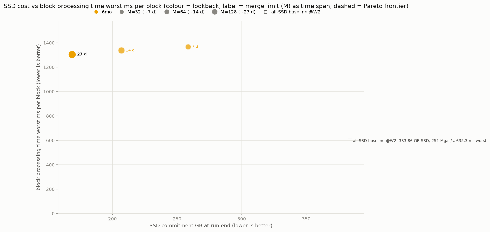
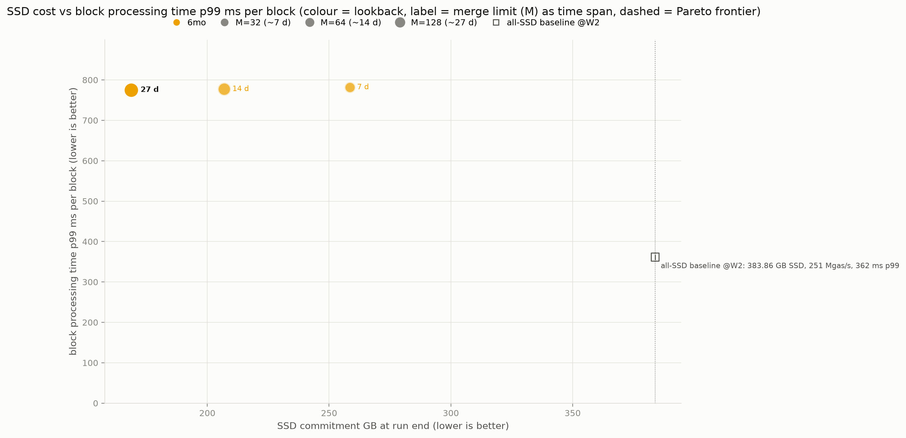
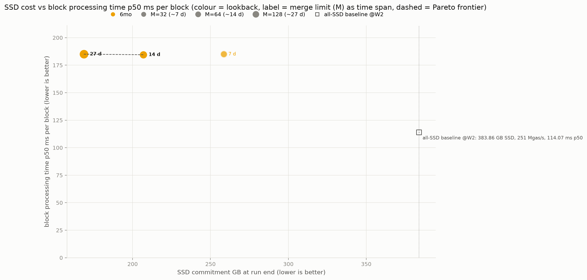
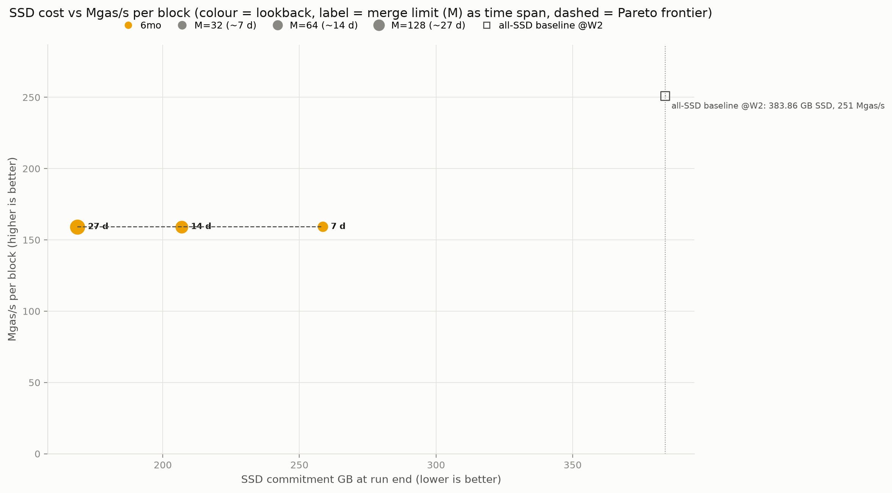

# W2 with a contiguous cold layout on /sbackup: 6mo M=32 / 64 / 128, 10,000 blocks, 1 run each (stage 17.1)

Same build, blocks and settings as `../2026-11-26` (erigon f32236ec74, blocks 26,130,001..26,140,000, 64 GiB scope, caches dropped,
env `KV_READ_METRICS=false BAL_BATCH_PREFETCH=false`). The only change: the 7 cold commitment files (the same set for all three M)
were copied in step order into a new directory, so that they sit together on /sbackup (0-8192 at 25.6-218.2 GB, the other 6 at 218-304.6 GB of sda1).
In `../2026-11-26` the files were spread over about 8 GB to 1.07 TB of the partition.
All-SSD baseline in the charts: the 3 `w2_allssd_rN` runs of `../2026-11-26` (the cold layout does not apply to them).
block processing time: see `../2026-11-26/README.md`.

## Block processing time: worst case

## Block processing time: p99

## Block processing time: p50

## Throughput: Mgas/s

## All metrics

| metric | M=32 spread (3 runs) | M=32 contiguous | M=64 spread (3 runs) | M=64 contiguous | M=128 spread (3 runs) | M=128 contiguous | W, M=64 (`../2026-11-25/long_m64`) |
|---|---|---|---|---|---|---|---|
| block processing time per block mean / p50 / p99 / worst (ms) | 224 / 194 / 816-826 / 1447-1510 | 213.5 / 185.0 / 781.9 / 1367 | 224 / 193-194 / 824-829 / 1437-1499 | 213.5 / 184.5 / 777.4 / 1337 | 224 / 193-194 / 833-837 / 1444-1486 | 213.4 / 185.0 / 775.3 / 1305 | 207.5 / 151.4 / 1001.4 / 3111 |
| Mgas/s per block mean | 152.0-152.4 | 159.2 | 152.4-152.7 | 159.2 | 152.5-152.6 | 159.2 | 184.2 |
| SSD commitment at end | 259 GB | 258.5 GB | 207 GB | 206.9 GB | 169 GB | 168.7 GB | — |
| HDD reads per block | 44 | 44.1 | 44 | 44.1 | 44 | 44.0 | 48.4 |
| HDD r_await mean | 37.5-37.8 ms | 34.5 ms | 37.6-37.7 ms | 34.7 ms | 37.8 ms | 34.6 ms | 30.3 ms |

Run reports: `w2c_mN/metrics.md`; block processing data: `w2c_mN/block_processing.json`; chart data: `frontier/frontier.json`.
