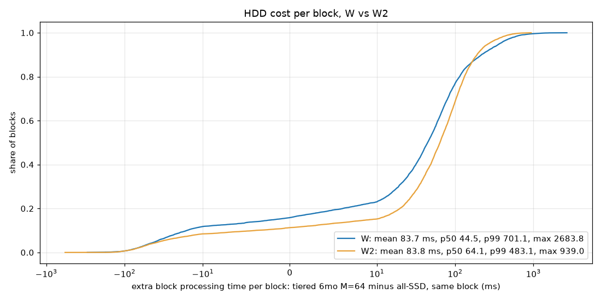
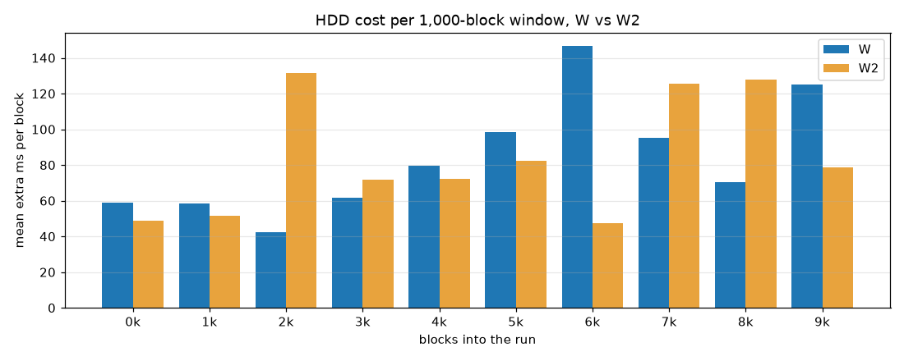

# W vs W2: where the HDD cost goes (stage 17.1, no new runs)

Same blocks compared per position: all-SSD vs tiered 6mo M=64, block processing time per block from the run logs
(definition: `../2026-11-25/README.md`). W: `../2026-11-25/allssd` vs `../2026-11-25/long_m64`.
W2: `../2026-11-26/w2_allssd_r1` vs `../2026-11-27/w2c_m64` (contiguous cold layout). Data: `w_vs_w2/summary.json`; script: `scripts/tv2_w_vs_w2.py`.
Extra = tiered minus all-SSD for the same block. The two runs are separate, so a block can come out negative (run-to-run noise).

## Extra time per block from the HDD (distribution)

## Extra time per 1,000-block window

## All metrics

| | W | W2 |
|---|---|---|
| gas per block mean / p50 / p90 | 30.3 / 28.4 / 50.2 M | 30.3 / 29.5 / 45.4 M |
| txs per block mean / p50 | 241 / 218 | 278 / 259 |
| all-SSD block processing time p50 / p99 / max | 107 / 376 / 777 ms | 114 / 367 / 801 ms |
| tiered block processing time p50 / p99 / max | 151 / 1,001 / 3,111 ms | 184 / 770 / 1,316 ms |
| extra per block mean / p50 / p90 / p99 / max | 83.7 / 44.5 / 217 / 701 / 2,684 ms | 83.8 / 64.1 / 191 / 483 / 939 ms |
| HDD reads per block / r_await mean | 48.4 / 30.3 ms | 44.1 / 34.7 ms |
| cold commitment files on HDD | 4 files, 186 GB | 7 files, 262 GB |
| HDD writes during the run | about 0.3 MB/s, no demotion | about 0, no demotion |
