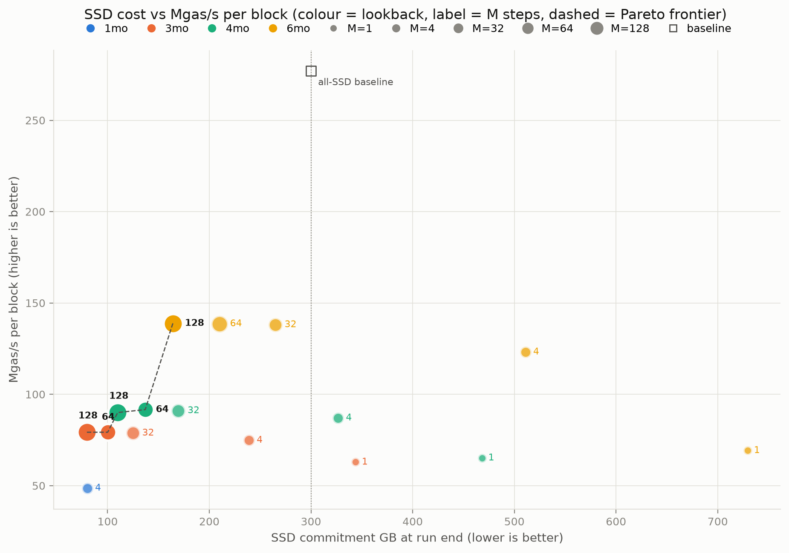
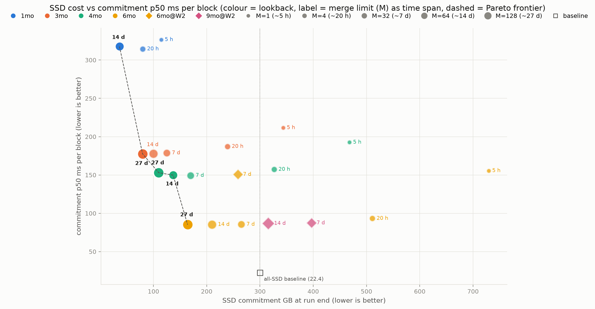
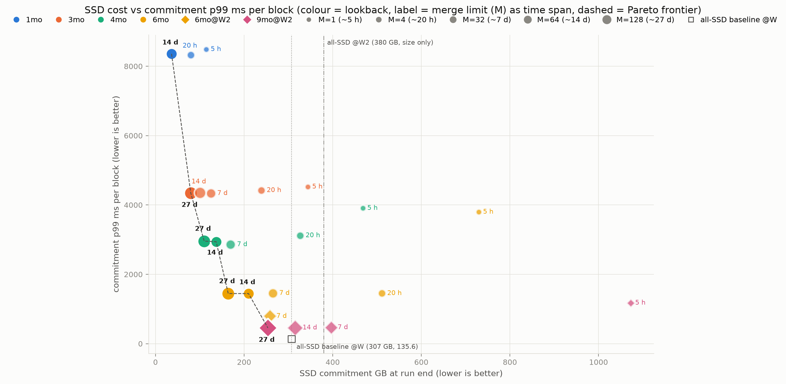
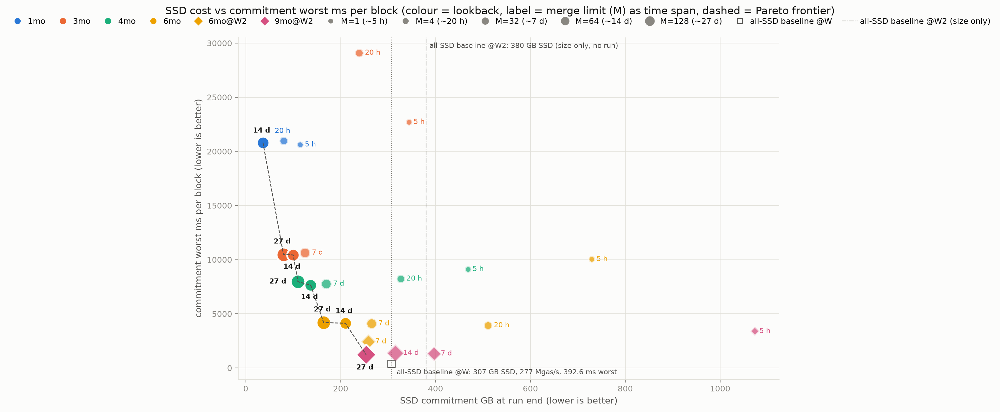
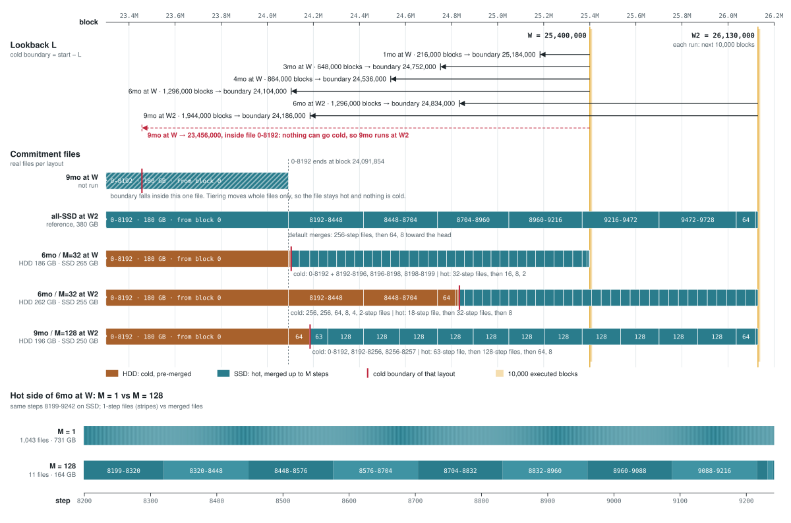

# Matrix run: lookback × SSD merge limit (stage 17)

Updated 2026-11-25T15:03:38Z. 23/23 cells done.

Each cell: 10,000 chaintip blocks 25,400,001..25,410,000 from W = 25,400,000, demotion on, offline BALs, state cache on,
`--tiering.cold-io-max-mbps=50`, erigon c604cf14, 64 GiB memory scope (page cache included), page caches dropped before the start.
L = lookback (cold boundary = W − L), M = SSD merge limit for commitment files (`--tiering.commitment-hot-merge-steps`).
Cold files are pre-merged and on HDD; hot files on SSD are merged up to M steps. All-SSD baseline (256-step merges):
277 Mgas/s per block (p50 / p5 / p1: 272.0 / 128.6 / 83.8), SSD commitment 307 GB (`baseline_allssd_merged_6mo_w25400000_2026-10-23-3`).
All-SSD commitment at W2 (default `seg retire` of `tv2_1s_base_w2`, size only, no run): 380 GB.
Mgas/s per block = mean of the per-block value; p50/p5/p1 come from the `exec_block_mgas_per_sec` histogram
(bucket edges 5, 10, 20, 30, 40, 50, 60, 80, 100, 125, 150, 200, 300; linear inside a bucket). SSD/HDD GB = commitment `.kv` bytes per tier at the run end.

### W2 (second start block, for 9mo)

W2 = 26,130,000. Cells marked `@W2` (diamonds in the frontier) run blocks 26,130,001..26,140,000 from base `tv2_1s_base_w2`.
Commitment data below block 24,091,854 is one 180 GB file (0-8192), and tiering moves only whole files. At W the 9mo boundary
is 25,400,000 − 1,944,000 = 23,456,000, inside that file, so nothing could go to HDD. At W2 it is 24,186,000, above it.
`6mo@W2/32` is the anchor: compared with `6mo/32` at W, it shows how much the block range alone changes the numbers.
12mo would need W2 ≥ ~26.69M, beyond the data on this box (ends at 26,147,580).

## Conclusions

- **Lookback sets the speed.** With M ≥ 32: 48 Mgas/s (1mo), 79 (3mo), 91 (4mo), 139 (6mo), 149–153 (9mo@W2); all-SSD is 277.
  A shorter lookback gives more HDD reads per block (HDD probes per block: 1,064 at 1mo/64, 286 at 6mo, 146 at 9mo@W2).
- **M sets the SSD size.** 6mo: 729 → 511 → 265 → 210 → 164 GB for M = 1, 4, 32, 64, 128. Each merged file keeps one copy
  of each changed trie node, so many small files keep many copies.
- **The knee is M = 32.** Above 32, speed changes by ≤ 1 % (9mo@W2: +2.7 % at 128). M = 128 is the best cell for every
  lookback: the least SSD at the same or better speed. Frontier: 1mo/64, 3mo/128, 4mo/128, 6mo/128, 9mo@W2/128.
- **Small M does not pay.** M = 1 costs 50 % of the speed at 6mo and 58 % at 9mo@W2; M = 4 costs 11 % at 6mo and 5–6 % at
  3mo/4mo. At 1mo, M has almost no effect (46.9–48.6), because HDD reads dominate. 1-step files cost a lot of SSD:
  6mo/1 uses 729 GB and 9mo@W2/1 uses 1,073 GB, more than all-SSD (307 / 380 GB).
- **Best trade-off at W:** 6mo/128 uses 46 % less SSD than all-SSD (164 vs 307 GB) at 50 % of its speed.
  At W2, 9mo/128 uses 33 % less (254 vs 380 GB) at 153 Mgas/s.
- **HDD placement changes the W2 numbers.** 6mo@W2/32 (99 Mgas/s) is slower than 6mo/32 at W (138) mainly because its cold
  files are far apart on the HDD (long seeks), not because of the block range. In short tests with the same cold files
  placed close together on the disk, 6mo@W2 gave 137–140 Mgas/s.

Skipped: 1mo/32 and 1mo/128 (1mo is too slow), 9mo@W2/4 (not enough SSD space).

## Charts

## Cells (in run order, `order.txt`)

| # | L | M | Mgas/s per block mean / p50 / p5 / p1 | wall Mgas/s | commit p50 / p95 / p99 ms | SSD GB | HDD GB | hot files | SSD / HDD probes per block | demotions (GB) | cold merges | duration h | rc / root err / OOM / peak GiB |
|---|---|---|---|---|---|---|---|---|---|---|---|---|---|
| 1 | [6mo/32](cells/6mo_m32/) | 32 | 138.1 / 133.6 / 36.7 / 21.6 | 62.5 | 85.6 / 693.7 / 1,457.1 | 265.0 | 185.6 | 33 | 7,752 / 286 | 0 (0) | 0 | 1.35 | 0 / 0 / 0 / 64.0 |
| 2 | [3mo/64](cells/3mo_m64/) | 64 | 79.3 / 76.1 / 16.9 / 9.6 | 38.9 | 177.8 / 1,946.9 / 4,350.6 | 100.1 | 247.6 | 9 | 4,624 / 543 | 0 (0) | 0 | 2.16 | 0 / 0 / 0 / 64.0 |
| 3 | [6mo/1](cells/6mo_m1/) | 1 | 69.2 / 67.2 / 18.2 / 10.8 | 37.8 | 155.6 / 1,731.0 / 3,799.0 | 729.4 | 189.3 | 1,043 | 162,433 / 278 | 5 (6.0) | 3 | 2.23 | 0 / 0 / 0 / 64.0 |
| 4 | [6mo/128](cells/6mo_m128/) | 128 | 138.8 / 134.1 / 37.2 / 21.7 | 62.6 | 85.2 / 684.9 / 1,446.0 | 164.2 | 185.6 | 9 | 4,340 / 286 | 0 (0) | 0 | 1.35 | 0 / 0 / 0 / 64.0 |
| 5 | [3mo/128](cells/3mo_m128/) | 128 | 79.2 / 76.0 / 16.9 / 9.4 | 39.0 | 177.6 / 1,933.1 / 4,344.3 | 79.6 | 247.6 | 5 | 3,866 / 542 | 0 (0) | 0 | 2.16 | 0 / 0 / 0 / 64.0 |
| 6 | [3mo/32](cells/3mo_m32/) | 32 | 78.8 / 75.6 / 16.7 / 9.2 | 38.8 | 178.8 / 1,957.2 / 4,337.7 | 124.9 | 247.6 | 17 | 6,151 / 543 | 0 (0) | 0 | 2.17 | 0 / 0 / 0 / 64.0 |
| 7 | [6mo/64](cells/6mo_m64/) | 64 | 138.6 / 134.3 / 36.8 / 21.8 | 62.6 | 85.4 / 689.2 / 1,445.0 | 210.0 | 185.6 | 17 | 5,475 / 286 | 0 (0) | 0 | 1.35 | 0 / 0 / 0 / 64.0 |
| 8 | [6mo/4](cells/6mo_m4/) | 4 | 123.2 / 119.2 / 35.3 / 21.5 | 59.3 | 93.3 / 708.9 / 1,452.2 | 510.9 | 188.4 | 261 | 41,759 / 199 | 1 (3.6) | 1 | 1.42 | 0 / 0 / 0 / 64.0 |
| 9 | [4mo/64](cells/4mo_m64/) | 64 | 91.6 / 88.1 / 21.1 / 11.7 | 45.0 | 149.8 / 1,377.7 / 2,939.7 | 137.0 | 236.8 | 12 | 5,001 / 469 | 0 (0) | 0 | 1.87 | 0 / 0 / 0 / 64.0 |
| 10 | [4mo/4](cells/4mo_m4/) | 4 | 87.0 / 84.0 / 20.4 / 11.6 | 43.8 | 157.3 / 1,421.7 / 3,120.2 | 326.6 | 239.3 | 176 | 34,321 / 492 | 1 (1.9) | 2 | 1.92 | 0 / 0 / 0 / 64.0 |
| 11 | [4mo/32](cells/4mo_m32/) | 32 | 91.0 / 87.4 / 21.1 / 11.7 | 44.9 | 149.4 / 1,380.0 / 2,862.5 | 169.6 | 236.8 | 22 | 6,753 / 469 | 0 (0) | 0 | 1.88 | 0 / 0 / 0 / 64.0 |
| 12 | [3mo/1](cells/3mo_m1/) | 1 | 62.9 / 61.0 / 15.2 / 8.1 | 34.1 | 211.7 / 2,093.0 / 4,524.6 | 343.7 | 249.7 | 526 | 112,951 / 767 | 7 (4.8) | 4 | 2.47 | 0 / 0 / 0 / 64.0 |
| 13 | [4mo/1](cells/4mo_m1/) | 1 | 65.2 / 63.3 / 17.2 / 10.5 | 36.5 | 192.7 / 1,830.2 / 3,908.7 | 468.1 | 239.3 | 696 | 132,808 / 611 | 6 (4.2) | 4 | 2.31 | 0 / 0 / 0 / 64.0 |
| 14 | [3mo/4](cells/3mo_m4/) | 4 | 74.8 / 72.0 / 16.0 / 8.5 | 37.4 | 187.2 / 2,016.9 / 4,422.8 | 238.9 | 248.2 | 132 | 29,267 / 559 | 1 (1.7) | 2 | 2.25 | 0 / 0 / 0 / 64.0 |
| 15 | [4mo/128](cells/4mo_m128/) | 128 | 90.0 / 86.3 / 20.5 / 11.6 | 44.5 | 153.0 / 1,406.6 / 2,957.8 | 109.9 | 236.8 | 7 | 4,122 / 469 | 0 (0) | 0 | 1.89 | 0 / 0 / 0 / 64.0 |
| 16 | [1mo/4](cells/1mo_m4/) | 4 | 48.6 / 46.4 / 9.4 / 5.4 | 25.0 | 314.5 / 3,811.8 / 8,323.8 | 80.0 | 297.8 | 43 | 14,873 / 1,201 | 0 (0.0) | 0 | 3.37 | 0 / 0 / 0 / 64.0 |
| 17 | [1mo/1](cells/1mo_m1/) | 1 | 46.9 / 45.0 / 9.1 / 5.3 | 24.4 | 326.6 / 3,897.0 / 8,489.6 | 114.7 | 299.5 | 169 | 55,307 / 1,477 | 6 (3.9) | 3 | 3.45 | 0 / 0 / 0 / 64.0 |
| 18 | [1mo/64](cells/1mo_m64/) | 64 | 48.4 / 46.3 / 9.3 / 5.4 | 24.9 | 317.7 / 3,817.7 / 8,357.2 | 36.2 | 296.1 | 4 | 3,795 / 1,064 | 0 (0) | 0 | 3.38 | 0 / 0 / 0 / 64.0 |
| 21 | [6mo@W2/32](cells/6mo_m32_w2/) | 32 | 99.2 / 95.0 / 39.2 / 22.9 | 58.1 | 150.7 / 406.3 / 793.7 | 258.5 | 261.6 | 36 | 5,251 / 419 | 0 (0) | 0 | 1.45 | 0 / 0 / 0 / 64.0 |
| 22 | [9mo@W2/32](cells/9mo_m32_w2/) | 32 | 149.1 / 142.7 / 61.4 / 37.6 | 75.5 | 87.4 / 235.7 / 469.4 | 396.7 | 196.3 | 52 | 6,157 / 146 | 0 (0) | 0 | 1.12 | 0 / 0 / 0 / 64.0 |
| 23 | [9mo@W2/64](cells/9mo_m64_w2/) | 64 | 149.8 / 143.1 / 61.8 / 37.6 | 75.8 | 86.8 / 234.0 / 460.5 | 315.4 | 196.3 | 28 | 4,066 / 146 | 0 (0) | 0 | 1.11 | 0 / 0 / 0 / 64.0 |
| 24 | [9mo@W2/128](cells/9mo_m128_w2/) | 128 | 153.1 / 146.5 / 63.5 / 39.9 | 77.0 | 83.8 / 222.9 / 452.9 | 253.8 | 196.3 | 17 | 3,163 / 146 | 0 (0) | 0 | 1.09 | 0 / 0 / 0 / 64.0 |
| 25 | [9mo@W2/1](cells/9mo_m1_w2/) | 1 | 64.9 / 62.1 / 26.9 / 17.2 | 42.7 | 179.8 / 499.1 / 1,175.7 | 1,072.8 | 199.6 | 1,543 | 140,721 / 208 | 6 (5.2) | 4 | 1.97 | 0 / 0 / 0 / 64.0 |

Data: [`runs.csv`](runs.csv). Each cell folder has `layout_before.md`, `stats.json`, `metrics.md` + `images/`, and logs.

## Geometry (plan estimates; the real boundary is in each cell's `layout_before.md`)

| L | boundary block / step | cold set on HDD (besides 0-8192) | HDD GB | hot steps on SSD | 1-step hot GB |
|---|---|---|---|---|---|
| 6mo | 24,104,000 / 8199 | 8192-8196, 8196-8198 | ~186 | 1,043 | ~730 |
| 4mo | 24,536,000 / ~8543 | 8192-8448, 8448-8512, 8512-8528, +8+4+2+1 | ~225 | ~700 | ~490 |
| 3mo | 24,752,000 / 8714 | 8192-8448, 8448-8704, 8704-8712, 8712-8714 | ~248 | 528 | ~370 |
| 1mo | 25,184,000 / ~9066 | 8192-8448, 8448-8704, 8704-8960, 8960-9024, 9024-9056, +8+2 | ~290 | ~176 | ~125 |

## Setup diagram

