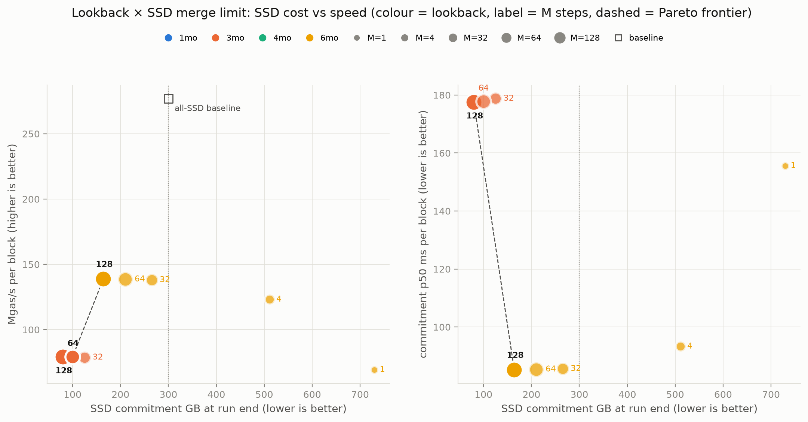
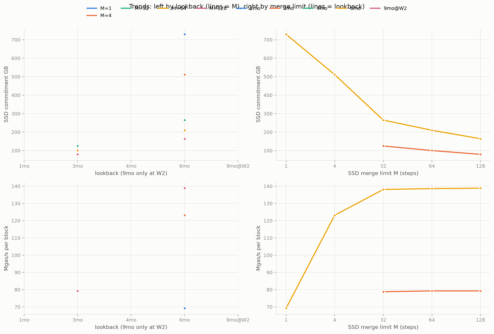
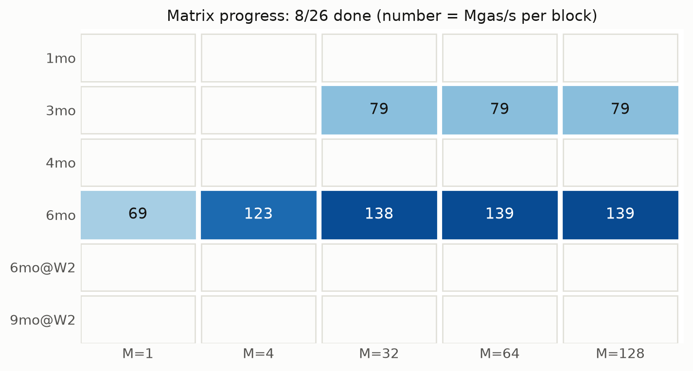

# Matrix run: lookback × SSD merge limit (stage 17)

Updated 2026-11-17T05:05:40Z. 8/26 cells done.

Each cell: 10,000 chaintip blocks 25,400,001..25,410,000 from W = 25,400,000, demotion on, offline BALs, state cache on,
`--tiering.cold-io-max-mbps=50`, erigon c604cf14, 64 GiB memory scope (page cache included), page caches dropped before the start.
L = lookback (cold boundary = W − L), M = SSD merge limit for commitment files (`--tiering.commitment-hot-merge-steps`).
Cold files are pre-merged and on HDD; hot files on SSD are merged up to M steps. All-SSD baseline (256-step merges):
277 Mgas/s per block, SSD commitment ≈ 300 GB (`baseline_allssd_merged_6mo_w25400000_2026-10-23-3`).
Cells marked `@W2` (diamonds in the frontier) run at W2 = 26,130,000 (blocks 26,130,001..26,140,000, base `tv2_1s_base_w2`):
9mo needs a cold boundary above the end of the 0-8192 file (block 24,091,854), which W cannot give; `6mo@W2/32` is the
same-range anchor against `6mo/32` at W. 12mo would need W2 ≥ ~26.69M, beyond the data on this box.
Mgas/s per block = mean of the per-block value; SSD/HDD GB = commitment `.kv` bytes per tier at the run end.

## Charts

## Cells (in run order, `order.txt`)

| # | L | M | Mgas/s per block | wall Mgas/s | commit p50 / p95 ms | SSD GB | HDD GB | hot files | SSD / HDD probes per block | demotions (GB) | cold merges | duration h | rc / root err / OOM / peak GiB |
|---|---|---|---|---|---|---|---|---|---|---|---|---|---|
| 1 | [6mo/32](cells/6mo_m32/) | 32 | 138.1 | 62.5 | 85.6 / 693.7 | 265.0 | 185.6 | 33 | 7,752 / 286 | 0 (0) | 0 | 1.35 | 0 / 0 / 0 / 64.0 |
| 2 | [3mo/64](cells/3mo_m64/) | 64 | 79.3 | 38.9 | 177.8 / 1,946.9 | 100.1 | 247.6 | 9 | 4,624 / 543 | 0 (0) | 0 | 2.16 | 0 / 0 / 0 / 64.0 |
| 3 | [6mo/1](cells/6mo_m1/) | 1 | 69.2 | 37.8 | 155.6 / 1,731.0 | 729.4 | 189.3 | 1,043 | 162,433 / 278 | 5 (6.0) | 3 | 2.23 | 0 / 0 / 0 / 64.0 |
| 4 | [6mo/128](cells/6mo_m128/) | 128 | 138.8 | 62.6 | 85.2 / 684.9 | 164.2 | 185.6 | 9 | 4,340 / 286 | 0 (0) | 0 | 1.35 | 0 / 0 / 0 / 64.0 |
| 5 | [3mo/128](cells/3mo_m128/) | 128 | 79.2 | 39.0 | 177.6 / 1,933.1 | 79.6 | 247.6 | 5 | 3,866 / 542 | 0 (0) | 0 | 2.16 | 0 / 0 / 0 / 64.0 |
| 6 | [3mo/32](cells/3mo_m32/) | 32 | 78.8 | 38.8 | 178.8 / 1,957.2 | 124.9 | 247.6 | 17 | 6,151 / 543 | 0 (0) | 0 | 2.17 | 0 / 0 / 0 / 64.0 |
| 7 | [6mo/64](cells/6mo_m64/) | 64 | 138.6 | 62.6 | 85.4 / 689.2 | 210.0 | 185.6 | 17 | 5,475 / 286 | 0 (0) | 0 | 1.35 | 0 / 0 / 0 / 64.0 |
| 8 | [6mo/4](cells/6mo_m4/) | 4 | 123.2 | 59.3 | 93.3 / 708.9 | 510.9 | 188.4 | 261 | 41,759 / 199 | 1 (3.6) | 1 | 1.42 | 0 / 0 / 0 / 64.0 |
| 9 | 4mo | 64 | pending | | | | | | | | | | |
| 10 | 4mo | 4 | pending | | | | | | | | | | |
| 11 | 4mo | 32 | pending | | | | | | | | | | |
| 12 | 3mo | 1 | pending | | | | | | | | | | |
| 13 | 4mo | 1 | pending | | | | | | | | | | |
| 14 | 3mo | 4 | pending | | | | | | | | | | |
| 15 | 4mo | 128 | pending | | | | | | | | | | |
| 16 | 1mo | 4 | pending | | | | | | | | | | |
| 17 | 1mo | 1 | pending | | | | | | | | | | |
| 18 | 1mo | 64 | pending | | | | | | | | | | |
| 19 | 1mo | 32 | pending | | | | | | | | | | |
| 20 | 1mo | 128 | pending | | | | | | | | | | |
| 21 | 6mo@W2 | 32 | pending | | | | | | | | | | |
| 22 | 9mo@W2 | 32 | pending | | | | | | | | | | |
| 23 | 9mo@W2 | 64 | pending | | | | | | | | | | |
| 24 | 9mo@W2 | 128 | pending | | | | | | | | | | |
| 25 | 9mo@W2 | 1 | pending | | | | | | | | | | |
| 26 | 9mo@W2 | 4 | pending | | | | | | | | | | |

Data: [`runs.csv`](runs.csv). Each cell folder has `layout_before.md`, `stats.json`, `metrics.md` + `images/`, and logs.

## Geometry (plan estimates; the real boundary is in each cell's `layout_before.md`)

| L | boundary block / step | cold set on HDD (besides 0-8192) | HDD GB | hot steps on SSD | 1-step hot GB |
|---|---|---|---|---|---|
| 6mo | 24,104,000 / 8199 | 8192-8196, 8196-8198 | ~186 | 1,043 | ~730 |
| 4mo | 24,536,000 / ~8543 | 8192-8448, 8448-8512, 8512-8528, +8+4+2+1 | ~225 | ~700 | ~490 |
| 3mo | 24,752,000 / 8714 | 8192-8448, 8448-8704, 8704-8712, 8712-8714 | ~248 | 528 | ~370 |
| 1mo | 25,184,000 / ~9066 | 8192-8448, 8448-8704, 8704-8960, 8960-9024, 9024-9056, +8+2 | ~290 | ~176 | ~125 |
