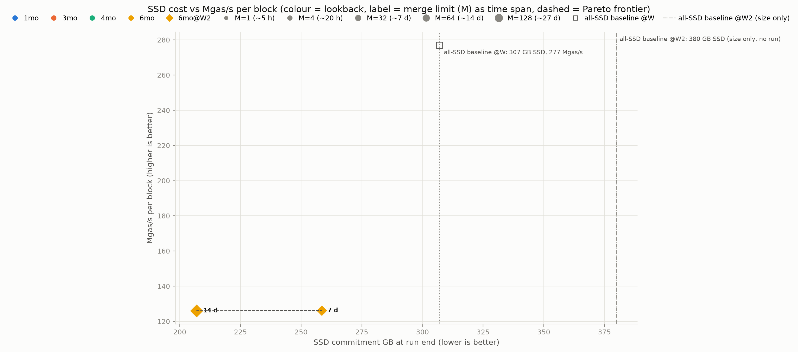
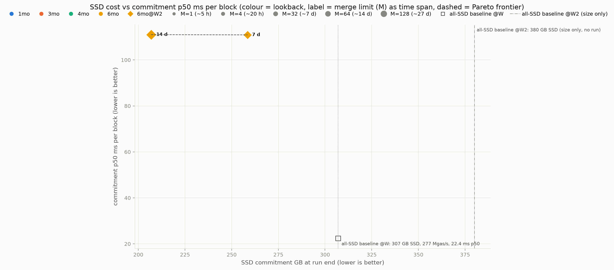
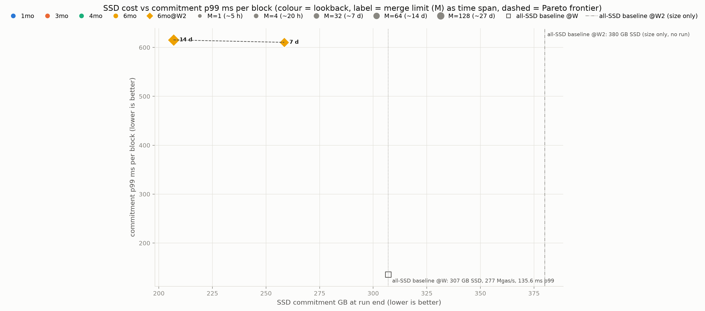
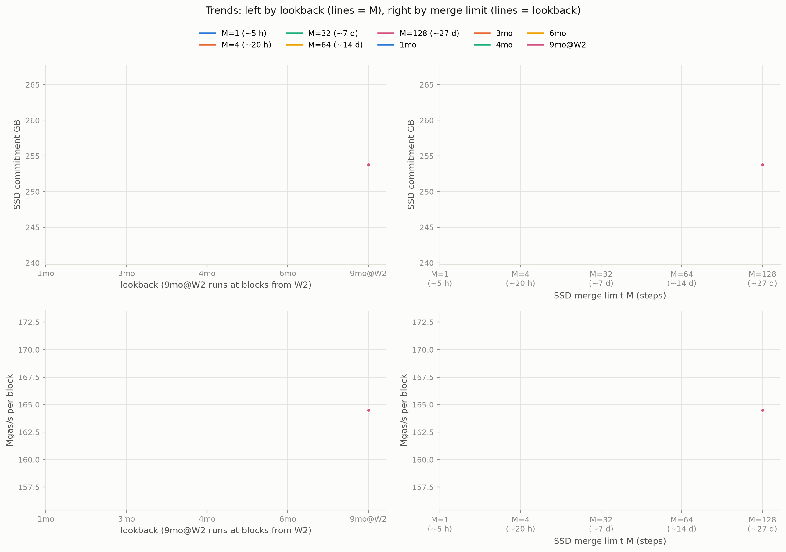
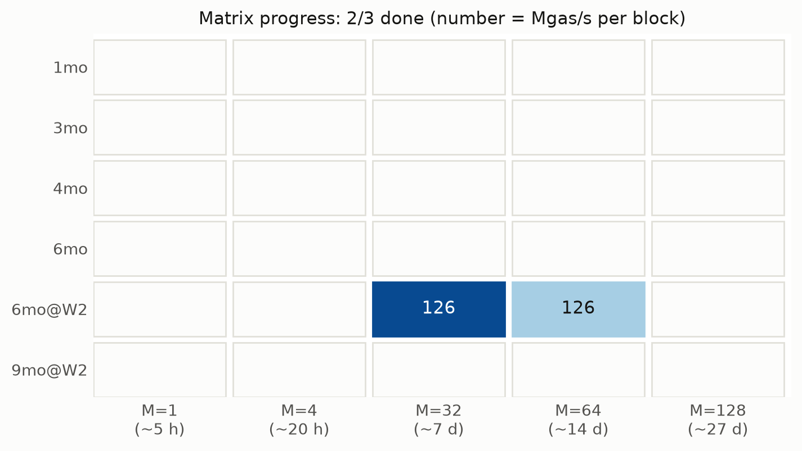

# Matrix run: lookback × SSD merge limit (stage 17)

Updated 2026-11-23T22:29:55Z. 2/3 cells done.

Each cell: 10,000 chaintip blocks 25,400,001..25,410,000 from W = 25,400,000, demotion on, offline BALs, state cache on,
`--tiering.cold-io-max-mbps=50`, erigon c604cf14, 64 GiB memory scope (page cache included), page caches dropped before the start.
L = lookback (cold boundary = W − L), M = SSD merge limit for commitment files (`--tiering.commitment-hot-merge-steps`).
Cold files are pre-merged and on HDD; hot files on SSD are merged up to M steps. All-SSD baseline (256-step merges):
277 Mgas/s per block, SSD commitment 307 GB (`baseline_allssd_merged_6mo_w25400000_2026-10-23-3`).
All-SSD commitment at W2 (default `seg retire` of `tv2_1s_base_w2`, size only, no run): 380 GB.
Mgas/s per block = mean of the per-block value; p50/p5/p1 come from the `exec_block_mgas_per_sec` histogram
(bucket edges 5, 10, 20, 30, 40, 50, 60, 80, 100, 125, 150, 200, 300; linear inside a bucket). SSD/HDD GB = commitment `.kv` bytes per tier at the run end.

### W2 (second start block, for 9mo)

W2 = 26,130,000. Cells marked `@W2` (diamonds in the frontier) run blocks 26,130,001..26,140,000 from base `tv2_1s_base_w2`.
Commitment data below block 24,091,854 is one 180 GB file (0-8192), and tiering moves only whole files. At W the 9mo boundary
is 25,400,000 − 1,944,000 = 23,456,000, inside that file, so nothing could go to HDD. At W2 it is 24,186,000, above it.
`6mo@W2/32` is the anchor: compared with `6mo/32` at W, it shows how much the block range alone changes the numbers.
12mo would need W2 ≥ ~26.69M, beyond the data on this box (ends at 26,147,580).

## Charts

## Cells (in run order, `order.txt`)

| # | L | M | Mgas/s per block mean / p50 / p5 / p1 | wall Mgas/s | commit p50 / p95 / p99 ms | SSD GB | HDD GB | hot files | SSD / HDD probes per block | demotions (GB) | cold merges | duration h | rc / root err / OOM / peak GiB |
|---|---|---|---|---|---|---|---|---|---|---|---|---|---|
| 1 | [6mo@W2/32](cells/6mo_m32_w2/) | 32 | 126.1 / 121.1 / 50.8 / 30.9 | 67.7 | 110.9 / 294.2 / 610.4 | 258.5 | 261.6 | 36 | 5,248 / 419 | 0 (0) | 0 | 1.24 | 0 / 0 / 0 / 64.0 |
| 2 | [6mo@W2/64](cells/6mo_m64_w2/) | 64 | 126.0 / 121.0 / 51.2 / 31.0 | 67.7 | 111.0 / 294.1 / 615.4 | 206.8 | 261.6 | 20 | 3,607 / 419 | 0 (0) | 0 | 1.24 | 0 / 0 / 0 / 64.0 |
| 3 | 9mo@W2 | 128 | pending | | | | | | | | | | |

Data: [`runs.csv`](runs.csv). Each cell folder has `layout_before.md`, `stats.json`, `metrics.md` + `images/`, and logs.

## Geometry (plan estimates; the real boundary is in each cell's `layout_before.md`)

| L | boundary block / step | cold set on HDD (besides 0-8192) | HDD GB | hot steps on SSD | 1-step hot GB |
|---|---|---|---|---|---|
| 6mo | 24,104,000 / 8199 | 8192-8196, 8196-8198 | ~186 | 1,043 | ~730 |
| 4mo | 24,536,000 / ~8543 | 8192-8448, 8448-8512, 8512-8528, +8+4+2+1 | ~225 | ~700 | ~490 |
| 3mo | 24,752,000 / 8714 | 8192-8448, 8448-8704, 8704-8712, 8712-8714 | ~248 | 528 | ~370 |
| 1mo | 25,184,000 / ~9066 | 8192-8448, 8448-8704, 8704-8960, 8960-9024, 9024-9056, +8+2 | ~290 | ~176 | ~125 |
